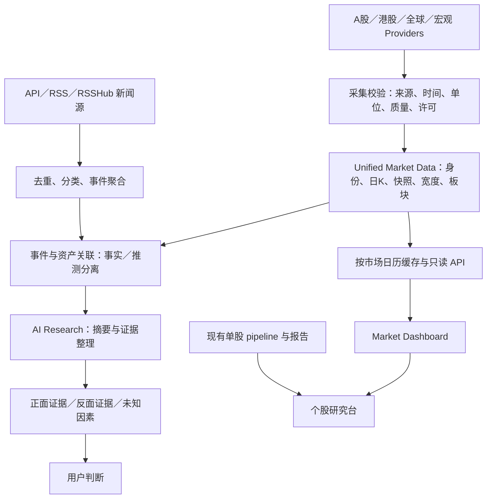

# a-stock-data：市场信息终端架构调研与现状审计

审计日期：2026-09-24。范围：只读调查；未修改仓库代码、未创建分支或提交。对应执行记录见桌面《大A数据-市场终端工作进度表-2026-09-24.xlsx》。

## 1. Executive Summary

当前项目已有较成熟的 A 股**单股分析与报告**流程，以及初步的 provider 身份、数据状态、质量和指数标识契约。距离“个人全球市场信息终端”仍有较大产品层缺口：缺统一的跨市场日 K、市场宽度、板块口径、市场新闻事件链、常驻只读 API 和首页。建议保持现有单股系统稳定，从市场数据契约开始小步建设。第一版先交付收盘后日 K 与可追溯事实；所有盘中值都须标来源、时间和延迟状态。

总体选择：借鉴 OpenBB 的标准模型和 provider 分层，自建较小的统一市场数据层。现阶段不整体引入 OpenBB 或多 agent 投资决策链。八张首页 K 线可以先用已有 ECharts 做原型，再与 Lightweight Charts 对比。

## 2. Current Architecture

- 本地分支 `phase0-ci-stabilization`，HEAD `74dc4f32b8a210a28afc719666b2421e6343aa20`，比远端同名分支领先 1 个提交。审计开始时存在未跟踪文档、脚本及报告；本轮没有改动。PR #1 已合并，未见开放 PR。
- `pyproject.toml` 的入口是 `analysis.quant_analyzer_v3:main`；`analysis/pipeline.py` 负责单股分析与交付。`analysis/quant_analyzer_v2.py`、`analysis/data_fetcher.py` 和 `analysis/sections/*/fetcher.py` 承担历史抓取。
- `analysis/fetcher_contract.py` 有 ok/empty/error/unsupported、来源、采集时间等返回契约；`analysis/research/{providers,capabilities,quality,index_registry,index_symbols}.py` 有身份和质量契约，但尚未形成已接线的市场数据路由器。
- `analysis/fetch_news_em.py` 抓单股东财／新浪新闻并按标题关键词分类；没有市场新闻去重、事件聚合。`analysis/html_report_v3.py` 用 ECharts 5.5.1 CDN 绘制静态单股 K 线和技术图；没有独立终端前端或常驻 API。
- 测试覆盖单股评分、三价位、抓取返回契约、报告和研究标识。`.github/workflows/ci.yml` 有 lint、pytest、mypy 诊断、单股 smoke；没有市场终端的验收测试。
- AKShare **已有局部可选调用**：`stock_hold_num_cninfo`、`stock_dividend_cninfo`、`stock_zt_pool_em`、`stock_zt_pool_zbgc_em`、`stock_zt_pool_dtgc_em`、`stock_lhb_detail_em`。但它不在 `pyproject.toml`／`requirements.txt` 依赖中，不是已成型的 AKShare provider。

## 3. Current Capability Map

| 能力 | 状态 | 边界 |
|---|---|---|
| A 股个股行情、财务、估值 | 已有且可复用 | 服务单股研究台 |
| 单股日 K、图表、报告 | 已有且可复用 | ECharts 静态报告，不是市场首页 |
| A 股指数 | 部分具备 | 有标识契约，缺统一行情服务 |
| 板块 | 部分具备 | 有个股关联数据，缺市场全景与固定分类 |
| 资金 | 已有但需要口径审计 | 个股东财字段不能直接成为可信板块榜 |
| 新闻 | 部分具备 | 单股采集与简单正负标题分类 |
| 宏观与全球市场 | 缺失 | 无统一日 K、时区、单位和数据授权映射 |
| 首页、常驻 API | 缺失 | 仅有单股静态 HTML |
| Cache | 部分具备 | 局部缓存／新鲜度契约，缺市场快照策略 |
| AI Research | 部分具备 | 数据契约与报告文字已有，无事件证据链 |
| Tests | 已有且可复用 | 新模块需独立测试 |
| Tick／分钟终端 | 当前阶段不需要 | 第一阶段日 K 优先 |

## 4. Open-source Benchmark

| 项目 | 具体观察 | 决定 |
|---|---|---|
| [AKShare](https://github.com/akfamily/akshare) | 指数、股票、板块、资金、港股、新闻、宏观接口广；底层常连接第三方网页接口。 | 候选 provider，逐接口验证稳定性、单位、许可；指数、板块、新闻均需备源。 |
| [OpenBB](https://github.com/OpenBB-finance/OpenBB) | Core、标准模型、provider 扩展、REST 分层；Fetcher 分查询转换、采集、结果转换。仓库 LICENSE 为 AGPL-3.0。 | 借标准化与可替换 provider 思想，不整体嵌入。 |
| [Lightweight Charts](https://github.com/tradingview/lightweight-charts) | 支持紧凑日 K、React、响应式及深色主题；不提供行情。Apache-2.0，需 TradingView 署名与 NOTICE。 | 首页图表候选；先与已有 ECharts 做八图性能和交互对比。 |
| [NewsNow](https://github.com/ourongxing/newsnow) | 仓库现位于 `newsnext/newsnow`。有独立 source getter、统一新闻条目、源级刷新间隔、TTL 和失败时旧缓存。 | 借 source/cache 思路；它没有可直接复用的跨源语义去重和事件聚合。 |
| [RSSHub](https://github.com/DIYgod/RSSHub) | namespace 路由、route 元数据、缓存和并发控制；AGPL-3.0。 | 可作隔离的部分新闻接入层；不用于权威行情。 |
| [OpenFR](https://github.com/oujingzhou/openfr) | 市场／财务／新闻／宏观分析员、多空文本辩论、内存 TTL 缓存、AKShare 降级。README 与包元数据称 MIT，审计时未见 LICENSE 文件。 | 借正反观点结构；暂不复制代码或接荐股节点。 |
| [TradingAgents](https://github.com/TauricResearch/TradingAgents) | 分析员、多空、风险角色和图状态传递。 | 借职责与反证设计；第一阶段不引入完整多 agent 图。 |
| [TradingAgents-Astock](https://github.com/simonlin1212/TradingAgents-astock) | 已处理 A 股代码辨识、mootdx 服务器探测、腾讯／东财降级、东财限速、板块资金和财联社新闻；当前数据层注明不用 AKShare。 | 借边界测试和故障处理；直接网页抓取、资金定义、荐股流程不照搬。 |
| [mootdx](https://github.com/mootdx/mootdx) | 通达信网络报价与 K 线、本地日线／分钟文件；当前仓库已依赖它。上游最近代码提交较早。 | 候选 A 股 fallback；实测连接、指数代码、当日 bar 和复权后再承诺时效。 |

新闻采集默认优先级：经授权 API → 发布方原生 RSS → 独立 RSSHub 服务 → 经许可自建 crawler。保存原文链接、发布时点、抓取时点及来源授权信息。

## 5. Gap Matrix

| 能力 | 当前 | 参考 | 建议 |
|---|---|---|---|
| A 股指数 | 仅标识契约 | AKShare、mootdx | 统一日 K contract，双源对账 |
| 全球指数／跨资产 | 缺失 | OpenBB 思路 | 明确品种、时区、币种、授权再接入 |
| 八张日 K | 仅单股 ECharts | Lightweight Charts | 先原型、再测组件 |
| 市场宽度 | 涨跌停池部分具备 | AKShare、交易所 | 固定股票样本、停牌／ST／北交所规则 |
| 行业／概念 | 单股关联数据 | AKShare、Astock | 分类版本和成分映射 |
| 板块资金 | 个股资金字段 | AKShare、Astock | 未审计“主力资金”口径前不展示榜单 |
| 新闻采集／缓存 | 单股新闻 | NewsNow、RSSHub | 新市场新闻源层，保留旧 fetcher |
| 去重／事件聚合 | 缺失 | NewsNow 源结构 | URL／标题去重，再评估语义聚合 |
| 事件行情关联 | 缺失 | OpenFR、TradingAgents | 先做时间与实体关联，因果归因单列不确定性 |
| 正反证据 | 标题关键词分类 | OpenFR、TradingAgents | 证据 ID、来源链接、未知与冲突字段 |

## 6. Data Source Matrix

下表均为**候选**，未完成逐端点上线实测。更新频率是产品目标，不是上游 SLA。缺来源时间戳时标“延迟未知”；历史日 K 不得称盘中实时。

| 数据 | Primary 候选 | Fallback 候选 | 更新频率 | 延迟／口径风险 | 稳定性 |
|---|---|---|---|---|---|
| A 股指数 | 交易所／指数公司接口或经验证 AKShare | mootdx／腾讯 | 收盘后日更 | 指数代码、成交量单位、当日 bar | 待实测 |
| 港股指数 | 授权指数源 | AKShare 港股接口 | 收盘后日更 | 恒生科技授权、时区 | 待实测 |
| 美股指数 | 授权全球行情源 | 独立授权源 | 收盘后日更 | 指数授权、盘后修订 | 待实测 |
| 日经 225 | 授权全球行情源 | 独立授权源 | 收盘后日更 | 日本假期、指数授权 | 待实测 |
| 黄金 | 明确品种的商品源 | 独立商品源 | 收盘后日更 | 现货／期货／ETF、币种不可混 | 待实测 |
| 原油 | 明确品种的商品源 | 独立商品源 | 收盘后日更 | WTI／Brent、合约换月 | 待实测 |
| 铜 | 明确品种的商品源 | 独立商品源 | 收盘后日更 | COMEX／LME／沪铜不可混 | 待实测 |
| VIX | Cboe 授权源；日收盘可评估 FRED VIXCLS | 独立授权源 | 日更 | FRED 仅日收盘，非盘中实时 | 日频清晰；时效待测 |
| DXY | 授权美元指数源 | 无同口径源则缺值 | 日更 | 其他广义美元指数不是 DXY | 授权风险高 |
| USD/CNH | 外汇报价源 | 独立外汇源 | 日更 | CNH／CNY、报价方向 | 待实测 |
| 美国 10Y | 美国财政部／FRED DGS10 | 独立债券源 | 日公布后 | 收益率非价格、非盘中实时 | 日频清晰 |
| 富时中国 A50 | 授权指数／期货源 | 无等价源则缺值 | 日更 | 现货指数与期货不可混 | 授权风险高 |
| 行业板块 | 固定分类体系及其来源 | 同体系备源 | 收盘后日更 | 分类及成分差异 | 待验证 |
| 概念板块 | 固定分类体系及其来源 | 同体系备源 | 收盘后日更 | 成分变化与回溯偏差 | 待验证 |
| 板块资金 | 暂不指定 | 暂不展示 | 待审计 | 主力／净流入定义未核实 | 高风险 |
| A 股市场宽度 | 全市场逐股快照 | 独立全市场快照 | 收盘后日更 | 样本、停牌、平盘、涨跌停规则 | 待验证 |
| 新闻 | 发布方 API／原生 RSS | RSSHub／经许可网页源 | 按源 5–30 分钟目标 | 发布时间≠抓取时间；版权 | 按源监测 |

## 7. Proposed Target Architecture

市场记录至少包含：`instrument_id`、`provider_id`、`provider_symbol`、交易日与交易所时区、OHLCV、币种／单位、复权口径、`as_of`、`fetched_at`、延迟状态及质量状态。事件记录另含原文链接、发布方、发布时间、首次抓取时间、去重组、关联资产和事实／推测标识。

## 8. Reuse / Build / Borrow Decision 与 License Matrix

| 能力／项目 | 决定 | 许可与边界 |
|---|---|---|
| 单股 pipeline、评分、三价位、报告 | REUSE | 保持业务含义 |
| 现有 provider／指数／质量契约 | REUSE | 增量扩展，不另建平行体系 |
| 市场模型、宽度、事件、证据对象 | BUILD | 项目自己定义口径 |
| OpenBB 分层与标准化 | BORROW IDEA | AGPL-3.0，避免复制／整体嵌入 |
| AKShare、mootdx | DEPENDENCY 候选 | MIT；数据源授权另审，mootdx 已为现有依赖 |
| Lightweight Charts | DEPENDENCY 候选 | Apache-2.0；NOTICE 与 TradingView 署名 |
| NewsNow source/cache | BORROW IDEA | MIT；内容版权另审 |
| RSSHub 新闻路由 | DEPENDENCY 候选，隔离部署 | AGPL-3.0；部署成本和路由稳定性待审 |
| OpenFR 多空流程 | BORROW IDEA | README 称 MIT，但未见 LICENSE 文件，暂不复制代码 |
| TradingAgents／Astock 辩论与降级思想 | BORROW IDEA | Apache-2.0；保留许可与 NOTICE |
| 整体 OpenBB、多 agent 荐股链、未经审计的主力资金榜 | DO NOT USE | 不符合第一阶段目标／存在许可或口径风险 |

代码开源许可不等于行情、指数或新闻转载许可。东财、腾讯、同花顺、财联社与指数发布方需分别确认抓取、展示、缓存和商业使用条款。

## 9. Phased Implementation Plan

| 阶段 | 目标与预计模块 | 不能碰的模块 | 测试与验收 | 主要风险 |
|---|---|---|---|---|
| M0 | 市场日 K／质量／延迟契约，`analysis/research/` 附近及文档 | pipeline、quant analyzer、公式和三价位 | 固定样本验证跨时区、缺值、单位、旧值；能表示延迟未知 | 过度设计 |
| M1 | 上证和沪深 300 双源日 K adapter | 旧单股抓取 | 双源对账日期、OHLC、单位；失败显式返回 | 接口限流 |
| M2 | 扩至八张核心日 K；只读 API 与首页图卡 | 旧报告页面 | 八品种均显示来源、时点或明确空态 | 授权、跨时区 |
| M3 | A 股市场宽度定义与收盘快照 | 评分公式 | 逐股计数与来源汇总对账 | 样本遗漏 |
| M4 | 行业／概念榜；资金另设口径门槛 | 单股资金因子含义 | 分类版本和成分核对；资金不明则不展示 | 板块重叠、伪精确 |
| M5 | `news/sources`、`collectors`、`cache` | 旧单股新闻 fetcher | URL／标题去重，旧缓存显示年龄 | 版权、删稿 |
| M6 | 事件、实体、行情时间窗关联 | 交易结论 | 人工标注误关联评估；显示不确定 | 强行归因 |
| M7 | 5–10 件事件的每日市场简报 | 量化评分 | 每条可追溯新闻和行情；无证据不生成数值 | AI 幻觉 |
| M8 | 正反证据、未知与冲突结构 | 三价位公式 | 证据 ID 可追溯，冲突不被抹平 | 信息过载 |

## 10. Risks

重点监控：数据接口改版和风控、API rate limit、provider 单点故障、分类和资金口径冲突、延迟行情被标成实时、旧缓存被误认作新数据、指数授权、新闻版权及抓取限制、AGPL 网络使用义务、AI 幻觉与强行归因，以及首页信息过载。上线前为每个数据源记录来源、时间戳、单位、失败率、许可和可用备源。

## 11. Recommended First Coding Task

只做 **M0：独立市场日 K 数据契约及单元测试**。字段包括统一标识、OHLCV、币种／单位、交易日、来源、`as_of`、`fetched_at`、延迟和质量状态。用两条固定样本验证上证与沪深 300；不接真实网络，不改现有 pipeline。验收是能明确区分有效收盘日 K、缺失、旧值和延迟未知。新增模块可独立删除回滚。

## 主要上游依据

- [OpenBB Provider Extensions](https://docs.openbb.co/odp/python/developer/extension_types/provider)、[Standardization](https://docs.openbb.co/odp/python/developer/standardization)、[LICENSE](https://github.com/OpenBB-finance/OpenBB/blob/develop/LICENSE)
- [AKShare index 源码](https://github.com/akfamily/akshare/tree/main/akshare/index)、[fund flow 源码](https://github.com/akfamily/akshare/blob/main/akshare/stock_feature/stock_fund_flow.py)
- [Lightweight Charts 文档与署名](https://tradingview.github.io/lightweight-charts/docs/5.0)、[React 示例](https://tradingview.github.io/lightweight-charts/tutorials/react/simple)
- [NewsNow source adapter](https://github.com/newsnext/newsnow/blob/main/server/utils/source.ts)、[缓存 API](https://github.com/newsnext/newsnow/blob/main/server/api/s/index.ts)
- [RSSHub route 示例](https://github.com/DIYgod/RSSHub/blob/master/lib/routes/10jqka/realtimenews.ts)、[LICENSE](https://github.com/DIYgod/RSSHub/blob/master/LICENSE)
- [OpenFR 状态](https://github.com/oujingzhou/openfr/blob/main/src/openfr/agents/utils/agent_states.py)、[缓存](https://github.com/oujingzhou/openfr/blob/main/src/openfr/tools/cache.py)
- [TradingAgents 状态](https://github.com/TauricResearch/TradingAgents/blob/main/tradingagents/agents/state.py)、[Astock 数据层](https://github.com/simonlin1212/TradingAgents-astock/blob/main/tradingagents/dataflows/a_stock.py)、[mootdx 网络接口](https://github.com/mootdx/mootdx/blob/master/mootdx/quotes.py)
- [FRED VIXCLS 日收盘数据](https://fred.stlouisfed.org/data/VIXCLS)
